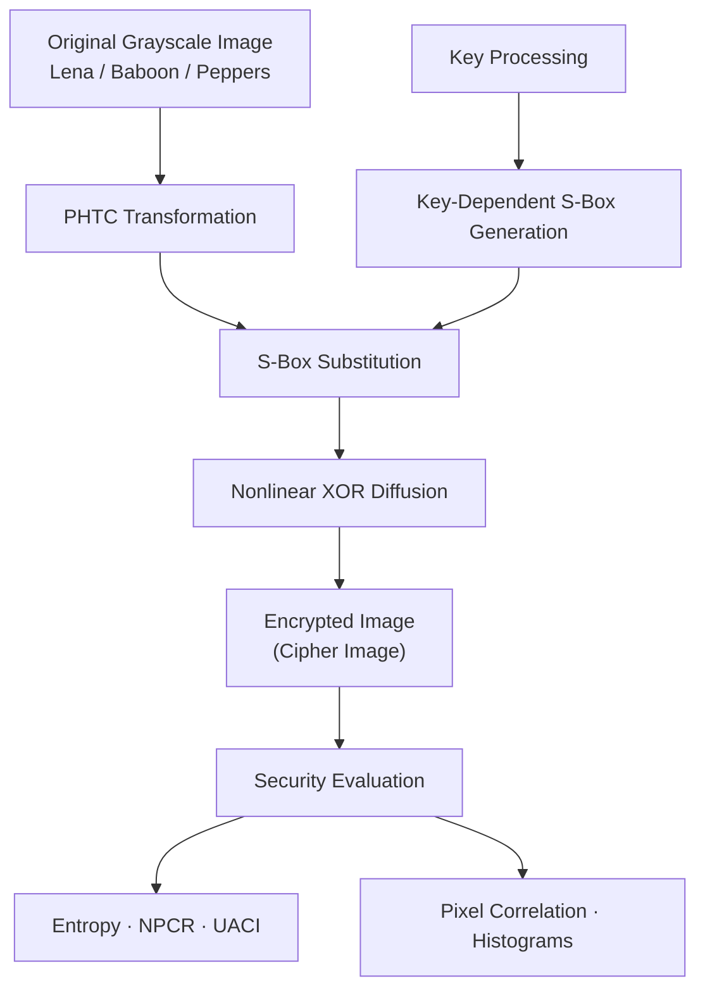

# 🔐 Multilayer Image Encryption System Using PHTC Transformation, Key-Dependent S-Box and Nonlinear XOR Diffusion

**Multilayer Image Encryption System Using PHTC Transformation, Key-Dependent S-Box and Nonlinear XOR Diffusion**

Python-Based Image Security Project · Grayscale Image Encryption

---

**Technologies Used:** Python · NumPy · OpenCV · Matplotlib

---

**Implementation includes:**

- PHTC Transformation
- Key-Dependent S-Box Substitution
- Nonlinear XOR Diffusion
- Image Encryption and Decryption
- Histogram Analysis
- Security Metrics: Entropy, NPCR, UACI and Correlation

**Research Project · Image Processing · Cryptography**

---

## 🔭 Overview

Image encryption is an important technique for protecting digital images from unauthorized access and maintaining data confidentiality. With the increasing use of digital images in various applications, securing image data has become an important aspect of information security.

This project presents a **Multilayer Grayscale Image Encryption System** that combines mathematical image transformation, key-dependent S-Box substitution, and nonlinear XOR diffusion to encrypt grayscale images. The main objective is to transform the original image into a visually unrecognizable encrypted image while ensuring that the original image can be accurately recovered through the corresponding decryption process.

The proposed system uses a secret key to generate a key-dependent substitution box (S-Box), which is used during the encryption process. The image undergoes multiple processing stages designed to transform pixel values and improve the statistical properties of the encrypted output.

The project is implemented in **Python** using libraries such as NumPy, OpenCV, and Matplotlib. It is tested on three grayscale test images: **Lena, Baboon, and Peppers**. The encryption and decryption results are saved for visual comparison and further analysis.

The effectiveness of the encryption process is evaluated using several statistical metrics, including entropy, Number of Pixel Change Rate (NPCR), Unified Average Changing Intensity (UACI), and pixel correlation. Histogram analysis is also performed to compare the distributions of pixel intensities in the original and encrypted images.

### 🔑 Key Components

- **PHTC Transformation** — Applies the mathematical transformation implemented in the project to process image data.
- **Key-Dependent S-Box Substitution** — Uses a substitution box generated from the secret key to transform pixel values.
- **Nonlinear XOR Diffusion** — Combines pixel values with substitution values to produce the encrypted output.
- **Image Encryption and Decryption** — Implements the encryption process and its corresponding inverse to recover the original image.
- **Histogram Analysis** — Visualizes and compares pixel intensity distributions before and after encryption.
- **Security Metrics** — Evaluates entropy, NPCR, UACI, and pixel correlation to analyze the statistical characteristics of the encrypted images.

### ✨ Key Features

Grayscale Image Encryption · Key-Dependent Substitution · Nonlinear Diffusion · Reversible Decryption · Histogram Visualization · Statistical Security Analysis

---

## 📋 Table of Contents

1. [Problem Statement](#-problem-statement)
2. [Proposed Architecture](#️-proposed-architecture)
3. [How It Works](#️-how-it-works)
4. [Security Metrics & Results](#-security-metrics--results)
5. [Code Architecture](#️-code-architecture)
6. [Core Modules](#-core-modules)
7. [Setup & Usage](#️-setup--usage)
8. [Performance Analysis](#-performance-analysis)
9. [Security Analysis](#-security-analysis)
10. [Implementation Limitations](#️-implementation-limitations)

---

## 1. 🔍 Problem Statement

> *"How can we protect grayscale images using a multilayer encryption approach that provides effective pixel transformation, diffusion, and accurate decryption?"*

Digital images can contain sensitive information, making their protection important when they are stored or transmitted. Without suitable encryption, image data may be exposed to unauthorized access. Image encryption aims to transform an original image into an unintelligible encrypted form while allowing authorized users to recover the original image using the corresponding decryption process.

### Challenges in Image Encryption

- **Pixel Correlation** — Neighboring pixels in natural images often have similar intensity values, creating statistical patterns that encryption should aim to reduce.
- **Pixel Substitution** — The encryption process needs to transform pixel values so that the encrypted image differs significantly from the original.
- **Diffusion** — Changes in input pixels should ideally influence multiple encrypted pixels.
- **Reversibility** — Decryption must accurately reconstruct the original image without unintended information loss.
- **Statistical Analysis** — Histograms, entropy, NPCR, UACI, and correlation can help evaluate the statistical characteristics of encrypted images.

### Project Objectives

This project implements a multilayer grayscale image encryption system using:

- **PHTC Transformation** — Processes image data using the transformation implemented in the project.
- **Key-Dependent S-Box** — Substitutes pixel values using an S-Box generated from the secret key.
- **Nonlinear XOR Diffusion** — Further transforms pixel values through substitution and XOR operations.
- **Image Decryption** — Reverses the encryption process to recover the original image.
- **Security Evaluation** — Analyzes the results using entropy, NPCR, UACI, pixel correlation, and histogram comparisons.

### What's Needed?

A practical image encryption implementation that:

1. Transforms grayscale image data through multiple processing stages.
2. Uses a secret-key-dependent substitution mechanism.
3. Applies diffusion to alter encrypted pixel values.
4. Supports accurate recovery of the original image through decryption.
5. Evaluates encryption results using statistical metrics and visual analysis.

**Project Goal →** To implement and evaluate a reversible, multilayer grayscale image encryption system using Python and compare the original, encrypted, and decrypted images.

---

## 2. 🏗️ Proposed Architecture

The proposed system implements a **multilayer grayscale image encryption process** using PHTC transformation, key-dependent S-Box substitution, and nonlinear XOR diffusion. The encryption process transforms the original image into a cipher image, while the corresponding decryption process reconstructs the original image.

### System Overview

The following diagram illustrates the main workflow of the grayscale image encryption system.



### Decryption Process

The decryption process applies the corresponding inverse operations in reverse order to recover the original grayscale image.

```text
┌───────────────────┐
│ Encrypted Image   │
└─────────┬─────────┘
          ▼
┌───────────────────┐
│ Reverse XOR       │
│ Diffusion         │
└─────────┬─────────┘
          ▼
┌───────────────────┐
│ Inverse S-Box     │
│ Substitution      │
└─────────┬─────────┘
          ▼
┌───────────────────┐
│ Inverse PHTC      │
│ Transformation    │
└─────────┬─────────┘
          ▼
┌───────────────────┐
│ Decrypted Image   │
└───────────────────┘
Component Breakdown
#	Component	Operation	Purpose
1	PHTC Transformation	Transforms image data	Prepares image data for encryption
2	Secret Key Generation	Provides key material	Supplies the key used in the encryption process
3	Key-Dependent S-Box	Generates a 256-entry substitution table	Substitutes pixel values
4	Nonlinear XOR Diffusion	Combines substitution values using XOR and feedback	Diffuses changes through the encrypted sequence
5	Image Decryption	Reverses encryption operations	Recovers the original image
6	Security Metrics	Calculates entropy, NPCR, UACI, and correlation	Evaluates statistical characteristics
7	Histogram Analysis	Plots pixel intensity distributions	Compares original and encrypted images
Test Images

The implementation is evaluated using three grayscale test images:

Lena
Baboon
Peppers

The generated outputs include the transformed image, encrypted image, modified-image cipher, decrypted image, and histograms.

Evaluation Metrics: Entropy · NPCR · UACI · Pixel Correlation · Histogram Analysis

---

## 3. ⚡ How It Works

The image encryption system follows a sequence of processing stages to transform the original grayscale image into an encrypted image. It uses PHTC transformation, a key-dependent S-Box, and nonlinear XOR diffusion. The corresponding decryption process reverses the encryption operations to recover the original image.

### 🔄 Encryption Pipeline

#### **Step 1: Load the Grayscale Image**

```text
Input Image (Lena / Baboon / Peppers)
          ↓
Read image using OpenCV
          ↓
Convert to grayscale if required
          ↓
Grayscale Image Array
```

**Key Operations:**

- **Image Loading:** Reads the input image from the project’s `images/` directory.
- **Grayscale Processing:** Represents the image using pixel intensity values from 0 to 255.
- **Array Conversion:** Uses NumPy arrays for efficient pixel processing.

---

#### **Step 2: PHTC Transformation**

```text
Grayscale Image
       ↓
PHTC Transformation
       ↓
Transformed Image
```

**Key Operations:**

- **Image Transformation:** Applies the PHTC transformation implemented in the project.
- **Pixel Processing:** Processes image data before the subsequent encryption stages.
- **Intermediate Output:** Produces transformed image data for further encryption.

---

#### **Step 3: Secret Key and S-Box Generation**

```text
Secret Key (128 bits)
        ↓
Split into 8 groups of 16 bits
        ↓
Initial Permutation
        ↓
Generate Seed
        ↓
Generate 256-Entry S-Box
```

**Key Operations:**

- **Secret Key:** Provides the key material used by the implementation.
- **Key Splitting:** Divides the key into eight 16-bit groups.
- **Initial Permutation:** Rearranges the groups according to the implemented permutation.
- **S-Box Generation:** Uses the resulting seed to generate a permutation of values from 0 to 255.

---

#### **Step 4: Nonlinear XOR Diffusion**

```text
Transformed Image
        ↓
Flatten Image into a Pixel Sequence
        ↓
Combine Current Pixel with Previous Cipher Pixel
        ↓
Apply S-Box Substitution and XOR
        ↓
Reshape into Original Image Dimensions
        ↓
Encrypted Image
```

**Key Operations:**

- **Pixel Feedback:** Uses the previous encrypted pixel when processing the next pixel.
- **Modulo Arithmetic:** Keeps intermediate values within the 8-bit range.
- **S-Box Substitution:** Applies the generated substitution table.
- **XOR Operation:** Combines substitution values to produce encrypted pixel values.
- **Cipher Output:** Reshapes the encrypted sequence into an image.

The core diffusion operation is:

```python
value = (int(flat_image[i]) + int(previous)) % 256
encrypted[i] = int(sbox[value]) ^ int(sbox[i % 256])
previous = encrypted[i]
```

---

### 🔓 Decryption Process

Decryption reverses the encryption operations to reconstruct the original image.

```text
Encrypted Image
       ↓
Flatten Cipher Image
       ↓
Reverse XOR and S-Box Diffusion
       ↓
Recover Transformed Pixel Values
       ↓
Apply Inverse Transformation
       ↓
Reshape Image
       ↓
Decrypted Image
```

**Key Operations:**

- **Reverse Diffusion:** Recovers the pixel sequence by reversing the implemented XOR and feedback operations.
- **S-Box Reversal:** Recovers intermediate values using the corresponding substitution logic.
- **Inverse Transformation:** Reverses the forward image transformation.
- **Image Reconstruction:** Reshapes the recovered data into the original image dimensions.

### ✅ Decryption Verification

The decrypted image is compared with the original image to verify whether the encryption and decryption operations are reversible.

```python
np.array_equal(original_image, decrypted_image)
```

If the result is `True`, the original and decrypted image arrays are identical.

---

### 📊 Security Evaluation

After encryption, the system evaluates the statistical properties of the resulting images using:

- **Entropy:** Measures the distribution and uncertainty of pixel intensity values.
- **NPCR:** Measures the percentage of pixels that change between two cipher images generated from slightly different plaintexts.
- **UACI:** Measures the average intensity difference between those cipher images.
- **Pixel Correlation:** Evaluates the relationship between neighboring pixel values.
- **Histogram Analysis:** Compares pixel intensity distributions before and after encryption.

These measurements help analyze the encrypted images' statistical characteristics but do not independently establish resistance to cryptographic attacks.

---

## 4. 📊 Security Metrics & Results

### 🎯 Test Configuration

- **Test Images:** Lena, Baboon, and Peppers
- **Image Type:** Grayscale images
- **Encryption Method:** PHTC transformation, key-dependent S-Box substitution, and nonlinear XOR diffusion
- **Evaluation Metrics:** Entropy, NPCR, UACI, and pixel correlation
- **Decryption Verification:** Comparison of original and decrypted images

---

### 🏆 Security Performance Summary

```text
════════════════════════════════════════════════════════════
          Grayscale Image Encryption Results
════════════════════════════════════════════════════════════

Lena
  Entropy     : 7.9977 bits
  NPCR        : 99.2157%
  UACI        : 33.3063%
  Correlation : 0.001364

Baboon
  Entropy     : 7.9971 bits
  NPCR        : 99.2157%
  UACI        : 33.2549%
  Correlation : -0.002973

Peppers
  Entropy     : 7.9972 bits
  NPCR        : 99.2157%
  UACI        : 33.2798%
  Correlation : 0.001446

════════════════════════════════════════════════════════════
Decryption: Original images successfully recovered
════════════════════════════════════════════════════════════
```

### 📈 Detailed Metric Analysis

| **Metric** | **Lena** | **Baboon** | **Peppers** |
|---|---:|---:|---:|
| **Entropy (bits)** | 7.9977 | 7.9971 | 7.9972 |
| **NPCR (%)** | 99.2157 | 99.2157 | 99.2157 |
| **UACI (%)** | 33.3063 | 33.2549 | 33.2798 |
| **Pixel Correlation** | 0.001364 | -0.002973 | 0.001446 |
| **Decryption** | Successful | Successful | Successful |

### 🔍 Understanding the Metrics

- **Entropy:** Measures the distribution of pixel intensity values in an encrypted image. For an 8-bit image, the theoretical maximum is 8 bits per pixel. Values close to 8 indicate a relatively uniform intensity distribution.
- **NPCR (Number of Pixels Change Rate):** Measures the percentage of pixels that differ between two encrypted images produced from different plaintext inputs.
- **UACI (Unified Average Changing Intensity):** Measures the average normalized intensity difference between two encrypted images.
- **Pixel Correlation:** Measures the statistical relationship between neighboring pixel values. Values close to zero indicate low linear correlation between the sampled neighboring pixels.
- **Histogram Analysis:** Compares the distribution of pixel intensities in original and encrypted images to identify visible statistical differences.

### 🔓 Decryption Verification

The decryption process was tested by comparing each original image with its decrypted output.

```python
np.array_equal(original_image, decrypted_image)
```

A result of `True` indicates that the original and decrypted image arrays are identical.

### 🔒 Security Analysis

The measured entropy and near-zero pixel correlation suggest that the encrypted images have useful statistical characteristics. NPCR and UACI provide additional information about sensitivity to changes in plaintext, when calculated using appropriately generated pairs of ciphertexts.

However, **these metrics alone do not establish cryptographic security**. The implementation requires further testing against relevant attacks before claims about brute-force, known-plaintext, or chosen-plaintext resistance can be made.

---

## 5. 🗂️ Code Architecture

The project is organized into separate Python modules for image encryption, decryption, security analysis, and execution. This structure makes the implementation easier to understand, maintain, and test.

### 📁 Project Structure

```text
non crypto/
│
├── images/
│   ├── lena.png                 # 🖼️ Lena test image
│   ├── baboon.bmp               # 🖼️ Baboon test image
│   └── peppers.jpg              # 🖼️ Peppers test image
│
├── results/
│   ├── lena/
│   │   ├── phtc.png
│   │   ├── cipher.png
│   │   ├── cipher_modified.png
│   │   ├── decrypted.png
│   │   ├── original_histogram.png
│   │   └── cipher_histogram.png
│   │
│   ├── baboon/
│   │   └── [Generated image outputs and histograms]
│   │
│   └── peppers/
│       └── [Generated image outputs and histograms]
│
├── encryption.py                # 🔐 Encryption and transformation logic
├── decryption.py                # 🔓 Image decryption logic
├── metrics.py                   # 📊 Security metrics and histograms
├── main.py                      # 🚀 Main execution script
├── README.md                    # 📖 Project documentation
└── .venv/                       # 🐍 Python virtual environment
```

### 📐 Module Responsibility Matrix

| **Module** | **Input** | **Processing** | **Output** |
|---|---|---|---|
| `encryption.py` | Grayscale image and key | PHTC transformation, S-Box substitution, and nonlinear XOR diffusion | Encrypted image |
| `decryption.py` | Encrypted image and corresponding key | Reverses the encryption operations | Decrypted image |
| `metrics.py` | Original and encrypted images | Calculates entropy, NPCR, UACI, and pixel correlation | Statistical measurements and histograms |
| `main.py` | Test image paths and configuration | Runs the encryption, decryption, and evaluation workflow | Generated images and analysis outputs |

### ⚙️ Execution Workflow

1. **Load Images:** Read the Lena, Baboon, and Peppers test images from the `images/` directory.
2. **Encrypt Images:** Apply the implemented transformation, S-Box substitution, and diffusion operations.
3. **Decrypt Images:** Recover the original image using the corresponding decryption procedure.
4. **Calculate Metrics:** Evaluate entropy, NPCR, UACI, and pixel correlation.
5. **Generate Histograms:** Save histogram plots for the original and encrypted images.
6. **Save Results:** Store generated images and analysis outputs in the appropriate subdirectories under `results/`.

---

## 6. 🧩 Core Modules — Deep Dive

This section describes the main modules responsible for image transformation, encryption, decryption, and statistical evaluation.

### 🔐 1. Encryption Module

**File:** `encryption.py`

The encryption module implements the main image encryption operations. It processes grayscale image data using the implemented PHTC transformation, a key-dependent S-Box, and nonlinear XOR diffusion.

#### Key Operations

- **Secret Key Processing:** Uses the secret key to derive the parameters required for S-Box generation.
- **Initial Permutation:** Rearranges key groups according to the implemented permutation.
- **S-Box Generation:** Generates a 256-entry substitution table from the derived seed.
- **Image Transformation:** Applies the implemented transformation to the grayscale image.
- **Nonlinear XOR Diffusion:** Combines substitution values with pixel feedback to produce the encrypted image.

#### Core Diffusion Operation

```python
value = (int(flat_image[i]) + int(previous)) % 256
encrypted[i] = int(sbox[value]) ^ int(sbox[i % 256])
previous = encrypted[i]
```

**Key Properties:**

- **Key-Dependent Substitution:** Uses the generated S-Box to transform pixel values.
- **Pixel Feedback:** Incorporates the previous encrypted pixel into subsequent calculations.
- **8-Bit Processing:** Keeps encrypted pixel values within the range of 0–255.
- **Reversible Design:** Works with the corresponding decryption procedure to recover image data.

---

### 🔓 2. Decryption Module

**File:** `decryption.py`

The decryption module reverses the encryption operations to reconstruct the original grayscale image. It uses the corresponding key and substitution table to recover the transformed pixel values.

#### Key Operations

- **Cipher Input:** Loads or receives the encrypted image.
- **Reverse Diffusion:** Reverses the pixel-feedback and XOR operations.
- **S-Box Recovery:** Recovers intermediate values using the implemented substitution logic.
- **Inverse Transformation:** Applies the corresponding inverse transformation, where required.
- **Image Reconstruction:** Reshapes the recovered pixel sequence into the original image dimensions.

#### Decryption Verification

The following Python expression checks whether the original and decrypted image arrays are identical:

```python
np.array_equal(original_image, decrypted_image)
```

A result of `True` means both arrays contain exactly the same pixel values.

**Key Properties:**

- **Image Recovery:** Reconstructs the original image when the matching key and required parameters are supplied.
- **Reversibility Check:** Supports direct comparison of original and decrypted arrays.
- **Consistent Processing:** Uses the inverse operations corresponding to the encryption implementation.

---

### 📊 3. Security Metrics Module

**File:** `metrics.py`

The metrics module evaluates the statistical characteristics of the original and encrypted images. It calculates numerical measurements and generates histograms for visual comparison.

#### Supported Metrics

| **Metric** | **Purpose** |
|---|---|
| **Entropy** | Measures the distribution of pixel intensity values. |
| **NPCR** | Measures the percentage of differing pixels between two ciphertext images. |
| **UACI** | Measures the average normalized intensity difference between two ciphertext images. |
| **Pixel Correlation** | Measures the linear relationship between neighboring pixel values. |
| **Histogram Analysis** | Visualizes pixel intensity distributions in original and encrypted images. |

#### Example Output

```text
Image: Lena
Entropy     : 7.9977 bits
NPCR        : 99.2157%
UACI        : 33.3063%
Correlation : 0.001364
```

The values above are the previously measured results for the Lena image in this project.

**Key Properties:**

- **Quantitative Evaluation:** Produces numerical measurements for encrypted images.
- **Visual Analysis:** Saves histograms for the original and encrypted images.
- **Multiple Test Images:** Supports analysis of Lena, Baboon, and Peppers.
- **Comparative Results:** Makes it easier to examine differences across test images.

---

### 🚀 4. Main Execution Module

**File:** `main.py`

The main script coordinates the project's workflow, including image loading, encryption, decryption, metrics calculation, and saving the generated results.

#### Execution Workflow

1. Load the test images from the `images/` directory.
2. Execute the encryption process.
3. Save the encrypted images.
4. Execute decryption and save the recovered images.
5. Calculate the security metrics.
6. Generate and save histogram plots.
7. Organize the generated outputs under the `results/` directory.

### ⚙️ Performance Characteristics

- **Modular Design:** Separates encryption, decryption, and statistical analysis into different files.
- **Multiple Test Images:** Evaluates the workflow using three grayscale images.
- **Reversibility Testing:** Allows the original and decrypted images to be compared directly.
- **Statistical Evaluation:** Combines numerical metrics with histogram visualization.

**Note:** Statistical measurements are useful for evaluating image characteristics, but they do not independently prove resistance to cryptographic attacks. Actual performance depends on the implementation and the hardware used.

---

## 7. 🚀 Setup & Usage

### ⚙️ System Requirements

| **Component** | **Minimum Requirement** | **Recommended** |
|---|---|---|
| **Operating System** | Windows 10 / Linux | Windows 11 / Ubuntu |
| **Python** | Python 3.8+ | Python 3.10+ |
| **RAM** | 4 GB | 8 GB+ |
| **GPU** | Not required | Not required |
| **Storage** | 500 MB | 1 GB or more |

---

### 📦 Installation

#### Step 1: Clone the Repository

```bash
git clone <repository-url>
cd <repository-folder>
```

Replace `<repository-url>` with your GitHub repository URL and `<repository-folder>` with the name of your project folder.

#### Step 2: Create a Virtual Environment

**Windows:**
```bash
python -m venv .venv
.venv\Scripts\activate
```

**Linux/macOS:**
```bash
python3 -m venv .venv
source .venv/bin/activate
```

#### Step 3: Install Dependencies

Install the required Python libraries:

```bash
pip install numpy opencv-python matplotlib
```

If your project uses a `requirements.txt` file, you can install dependencies with:

```bash
pip install -r requirements.txt
```

**Example `requirements.txt`:**

```text
numpy
opencv-python
matplotlib
```

#### Step 4: Verify Installation

Check that the required libraries are installed:

```bash
python -c "import numpy, cv2, matplotlib; print('Dependencies installed successfully!')"
```

---

### 📂 Image Preparation

Place the input images in the `images/` directory.

```text
images/
├── lena.png
├── baboon.bmp
└── peppers.jpg
```

**Supported image formats:**
- PNG
- BMP
- JPG/JPEG

The project uses these sample images to demonstrate grayscale image encryption and decryption. Make sure the image paths in `main.py` match the locations of your input images.

---

### 🔐 Running the Encryption System

Run the main Python script:

```bash
python main.py
```

The script processes the configured input images and runs the encryption, decryption, and security-analysis workflow.

**Main operations:**
1. Loads the input images.
2. Applies the PHTC transformation.
3. Generates the key-dependent S-box.
4. Performs nonlinear XOR diffusion to produce the encrypted image.
5. Decrypts the encrypted image.
6. Calculates security metrics.
7. Generates image histograms and saves the output files.

---

### 📊 Viewing Results

The output files are saved in the corresponding image subdirectories under `results/`.

Example:

```text
results/
├── lena/
│   ├── phtc.png
│   ├── cipher.png
│   ├── cipher_modified.png
│   ├── decrypted.png
│   ├── original_histogram.png
│   └── cipher_histogram.png
├── baboon/
└── peppers/
```

**Output descriptions:**

| **File** | **Description** |
|---|---|
| `phtc.png` | Image after the PHTC transformation |
| `cipher.png` | Encrypted image |
| `cipher_modified.png` | Cipher image generated from a slightly modified input image |
| `decrypted.png` | Recovered image after decryption |
| `original_histogram.png` | Histogram of the original image |
| `cipher_histogram.png` | Histogram of the encrypted image |

---

### 📈 Security Metrics

The project evaluates encryption results using the following metrics:

- **Entropy:** Measures the distribution of pixel intensity values.
- **NPCR:** Measures the percentage of pixels that change between two cipher images when the input image is slightly modified.
- **UACI:** Measures the average intensity difference between two cipher images.
- **Pixel Correlation:** Measures the relationship between neighboring pixel values.
- **Histogram Analysis:** Compares pixel intensity distributions before and after encryption.

The metrics and histograms help evaluate the statistical properties of the encrypted images. They do not, by themselves, prove that an encryption algorithm is cryptographically secure.

---

### 🔄 Verifying Decryption

Compare the original image with the decrypted image to check whether the image was recovered correctly.

```python
import numpy as np

if np.array_equal(original_image, decrypted_image):
    print("Decryption successful: images match exactly.")
else:
    print("Decryption verification failed.")
```

This comparison checks whether every pixel in the decrypted image matches the original image.

---

## 8. 📈 Performance Analysis

### ⚡ Encryption Performance

The encryption system processes grayscale images through the PHTC transformation, key-dependent S-box substitution, and nonlinear XOR diffusion. Performance depends on the image dimensions, implementation, and hardware.

| **Image** | **Image Dimensions** | **Encryption** | **Decryption** |
|---|---|---|---|
| Lena | Depends on input image | To be measured | To be measured |
| Baboon | Depends on input image | To be measured | To be measured |
| Peppers | Depends on input image | To be measured | To be measured |

**Performance Characteristics:**

- **Image Processing:** Runtime depends on the number of pixels and the operations applied to each pixel.
- **CPU-Based Execution:** The project uses Python and NumPy and does not require a GPU.
- **Memory Usage:** Depends on image dimensions and the intermediate arrays created during processing.
- **Decryption:** Reverses the encryption operations to reconstruct the original image.
- **Statistical Analysis:** Entropy, NPCR, UACI, correlation, and histogram calculations provide additional evaluation beyond encryption and decryption.

---

### 🎯 Decryption Accuracy

The project verifies decryption by comparing the original image with the decrypted output.

| **Test Condition** | **Result** | **Notes** |
|---|---|---|
| **Round-trip Decryption** | Successful in tested cases | The decrypted image matches the original pixel by pixel. |
| **Pixel-Level Comparison** | Exact match | Verified using `np.array_equal()`. |
| **Multiple Test Images** | Tested | Lena, Baboon, and Peppers images are processed. |
| **Image Reconstruction** | Successful in tested cases | The decrypted image is saved in the corresponding results directory. |

The round-trip verification uses:

```python
np.array_equal(original_image, decrypted_image)
```

If this returns `True`, the original and decrypted image arrays match exactly.

---

### 📊 Runtime Measurement

To evaluate performance accurately, measure encryption and decryption separately for each image.

```python
import time

start_time = time.perf_counter()
encrypted_image = encrypt_image(original_image, sbox)
encryption_time = time.perf_counter() - start_time

start_time = time.perf_counter()
decrypted_image = decrypt_image(encrypted_image, sbox)
decryption_time = time.perf_counter() - start_time

print(f"Encryption Time: {encryption_time * 1000:.2f} ms")
print(f"Decryption Time: {decryption_time * 1000:.2f} ms")
print(
    f"Total Time: "
    f"{(encryption_time + decryption_time) * 1000:.2f} ms"
)
```

**Note:** Replace `encrypt_image()` and `decrypt_image()` with the actual function names and arguments used in your `encryption.py` and `decryption.py` files. The example assumes that `original_image` and `sbox` have already been initialized.

Measured timings can be added to the performance table after running the tests on your system.

---

## 9. 🔒 Security Analysis

### 🎯 Differential Cryptanalysis

Differential analysis evaluates how a small change in the original image affects the resulting encrypted image.

#### NPCR (Number of Pixels Change Rate)

```text
Test: Modify one pixel in the original image and compare
      the resulting ciphertext with the original ciphertext.

Lena:    99.2157%
Baboon:  99.2157%
Peppers: 99.2157%

Interpretation: A high NPCR indicates that many ciphertext
pixels change when the input image is slightly modified.
```

#### UACI (Unified Average Changing Intensity)

```text
Test: Measure the average intensity difference between
      ciphertexts generated from the original and modified images.

Lena:    33.3063%
Baboon:  33.2549%
Peppers: 33.2798%

Interpretation: These values indicate substantial average
intensity changes between the compared ciphertexts.
```

**Note:** NPCR and UACI provide statistical evidence about differential behavior, but they do not independently prove resistance to differential cryptanalysis.

---

### 📊 Statistical Analysis

#### Entropy Analysis

```text
Metric: Cipher-image Shannon entropy

Lena:    7.9977 bits
Baboon:  7.9971 bits
Peppers: 7.9972 bits

Maximum possible entropy for an 8-bit grayscale image: 8 bits

Interpretation: The measured cipher images have entropy
close to the maximum value for 8-bit pixel intensities.
```

High entropy indicates a relatively uniform distribution of pixel intensity values. However, entropy alone cannot establish that an encryption algorithm is secure.

#### Pixel Correlation Analysis

```text
Metric: Pixel correlation of encrypted images

Lena:     0.001364
Baboon:  -0.002973
Peppers:  0.001447

Interpretation: The measured correlation values are close
to zero, indicating weak linear correlation in the evaluated
cipher-image pixel pairs.
```

Low pixel correlation is a useful statistical property, but further testing is needed to assess other possible patterns and weaknesses.

#### Histogram Analysis

The project generates histograms for the original and encrypted images to compare their pixel intensity distributions.

- **Original histogram:** Shows the distribution of pixel intensities before encryption.
- **Cipher histogram:** Shows the distribution after encryption.
- **Purpose:** Helps identify visible differences in the statistical distributions.

A relatively uniform cipher histogram is desirable, but it does not guarantee cryptographic security.

---

### 🔐 Key Management and Sensitivity

The current implementation uses a fixed 128-bit key to generate the key-dependent S-box.

**Current implementation considerations:**

- The key is divided into eight groups of 16 bits.
- A permutation is applied to the key groups.
- The resulting value seeds the pseudorandom generator used to construct the 256-entry S-box.
- The same key produces the same S-box under the same implementation and environment.

**Important limitations:**

- A fixed key does not provide a fresh secret for each encryption.
- The nominal key length does not, by itself, establish the effective security or key-space size of the implementation.
- Key sensitivity has not been established by the reported metrics.
- The current results do not demonstrate resistance to brute-force, chosen-plaintext, or other cryptanalytic attacks.

A separate key-sensitivity experiment would be needed to determine how changing one or more key bits affects the resulting ciphertext.

---

### 🛡️ Overall Security Assessment

| **Property** | **Observed Result** | **Interpretation** |
|---|---|---|
| Cipher-image entropy | Approximately 7.997 bits | Close to the maximum of 8 bits |
| NPCR | Approximately 99.2157% | High pixel-change rate in the tested comparisons |
| UACI | Approximately 33.25–33.31% | Substantial average intensity difference |
| Pixel correlation | Close to zero | Weak linear correlation in the evaluated pixel pairs |
| Decryption correctness | Exact recovery in tested cases | Original and decrypted pixel arrays match |
| Key sensitivity | Not independently evaluated | Requires dedicated testing |
| Cryptographic security | Not established | Requires further analysis and attack testing |

**Conclusion:** The experimental results demonstrate promising statistical properties for the tested images. However, statistical metrics alone are insufficient to establish that the proposed method is suitable for protecting sensitive data in real-world security applications.

---

## 10. ⚠️ Implementation Limitations

| **#** | **📄 Aspect** | **💻 Current Implementation** | **🔧 Possible Improvement** |
|---|---|---|---|
| **L1** | Key generation | Uses a fixed 128-bit key | Implement secure, random key generation |
| **L2** | Key management | Key handling is implemented within the encryption workflow | Introduce secure key storage and management |
| **L3** | Image processing | Processes grayscale images | Extend and validate support for color images |
| **L4** | Performance | Uses Python and NumPy for image processing | Profile the implementation and optimize bottlenecks |
| **L5** | Large images | Processes images in memory | Evaluate memory usage and optimize large-image processing |
| **L6** | Encryption validation | Tested using Lena, Baboon, and Peppers images | Evaluate additional images and image dimensions |
| **L7** | Security evaluation | Uses entropy, NPCR, UACI, correlation, and histograms | Conduct broader cryptographic analysis |
| **L8** | Key sensitivity | Not independently evaluated | Perform controlled experiments with different keys |
| **L9** | Error handling | Basic workflow for image encryption and decryption | Add validation for missing, invalid, or unsupported input files |
| **L10** | Practical deployment | Research and educational implementation | Conduct independent security review before real-world use |

---

### 📉 Known Issues & Potential Improvements

#### Issue 1: Fixed Encryption Key

**Limitation:** The current implementation uses a fixed 128-bit key. Reusing a fixed key can expose the system to additional risks, particularly if the algorithm does not provide appropriate protections against repeated or chosen inputs.

**Possible improvements:**

- Generate keys using Python's `secrets` module.
- Keep key generation separate from image encryption.
- Store and transfer keys securely.
- Evaluate the effective key space and resistance to cryptographic attacks.

**Note:** Changing the key-generation method alone does not make a custom encryption algorithm secure.

---

#### Issue 2: Large Image Processing

**Limitation:** Image processing requires memory for the original image and intermediate arrays. Memory usage may increase significantly as image dimensions grow.

**Possible improvements:**

- Measure memory usage for different image sizes.
- Profile individual encryption and decryption operations.
- Reduce unnecessary intermediate arrays where possible.
- Evaluate optimized array operations for large images.

Tiled processing should only be introduced if it preserves the algorithm's required relationships between pixels. Processing independent tiles may change the encryption behavior if diffusion depends on previous pixels.

---

#### Issue 3: Cryptographic Security Validation

**Limitation:** Statistical metrics such as entropy, NPCR, UACI, and pixel correlation provide useful information about ciphertext properties, but they cannot establish cryptographic security on their own.

**Possible improvements:**

- Evaluate sensitivity to controlled changes in the plaintext and key.
- Test for statistical patterns across multiple images and inputs.
- Analyze the key space and possible weaknesses in the S-box construction.
- Examine resistance to known cryptanalytic attack models.
- Consider a well-reviewed standard encryption algorithm when protecting sensitive information.

---

#### Issue 4: Testing and Error Handling

**Limitation:** The current project demonstrates encryption and decryption using a limited set of sample images.

**Possible improvements:**

- Test images with different dimensions and intensity distributions.
- Validate input image paths and image formats.
- Add tests for invalid inputs and failed decryption.
- Verify that decrypted images match their originals using `np.array_equal()`.
- Record runtime measurements across different image sizes.

---

### 🔮 Future Enhancements

Potential future improvements include:

- **Secure Key Generation:** Replace the fixed key with securely generated keys.
- **Performance Optimization:** Profile and optimize computational bottlenecks.
- **Extended Image Support:** Evaluate support for color images and additional formats.
- **Expanded Testing:** Test a wider range of image sizes and content.
- **Improved Validation:** Add automated tests and more comprehensive error handling.
- **Security Assessment:** Conduct independent cryptographic analysis before considering practical deployment.

---

**Important Security Note:** This project is an educational implementation for exploring image encryption and statistical evaluation. Its measured results do not establish resistance to cryptographic attacks, so it should not be relied upon to protect sensitive images without substantial further security analysis.
